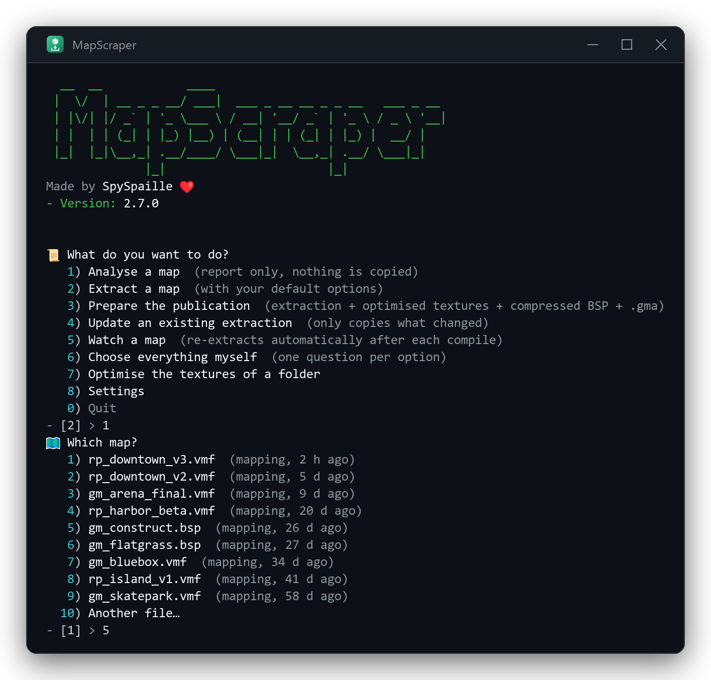
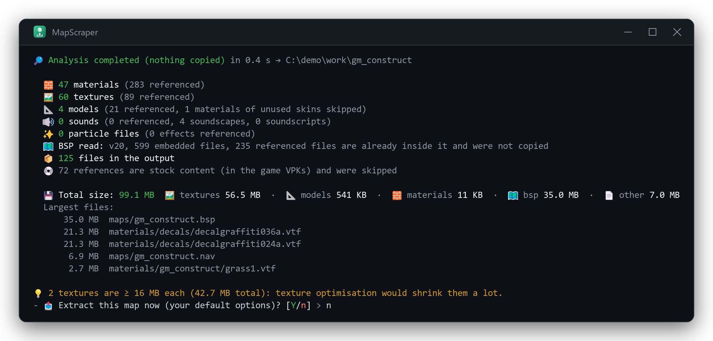

<p align="center"></p>

<h1 align="center">MapScraper</h1>

<p align="center"><b>Extract every asset a Source Engine / Garry's Mod map depends on, ready for the Steam Workshop.</b></p>

<p align="center">
  <a href="https://github.com/SpySpaille/MapScraper/releases/latest"></a>
  <a href="https://github.com/SpySpaille/MapScraper/releases"></a>
  <a href="https://github.com/SpySpaille/MapScraper/actions/workflows/ci.yml"></a>
  
  
  
</p>

<p align="center">
  <a href="https://github.com/SpySpaille/MapScraper/releases/latest"><b>Download</b></a> ·
  <a href="#quick-start">Quick start</a> ·
  <a href="#command-line">Command line</a> ·
  <a href="#security-and-privacy">Security</a> ·
  <a href="CHANGELOG.md">Changelog</a>
</p>

<p align="center"></p>

MapScraper reads a map's `.vmf`, its compiled `.bsp`, or both, works out every material, texture, model, sound,
soundscape, particle and misc file it needs, and copies them into a folder (and optionally a `.gma`) that is ready to be
published. Whatever it cannot find is reported together with **who uses it**, down to the Hammer entity.

## Why MapScraper

- **It finds everything.** Brushes, displacements, props, sprites, sounds and soundscripts, soundscapes, particle systems,
  instances, I/O parameters, `lua_run` code, and what the compiled BSP carries (entities, material table, static props,
  embedded pakfile). Only the model skins the map really uses are copied.
- **It tells you what is broken.** Every missing file comes with its chain of referrers, up to the entity id, name and position
  (or the brush id) so that a broken reference can be fixed instead of guessed.
- **It knows the workshop.** Installed addons are indexed: files they provide become *required items*, can be extracted
  (`--from-workshop`) or left out (`--exclude-workshop`), and the tool suggests which items already hold files you are about to ship.
- **It is ready to publish.** Native `.gma` writer, whitelist enforced, files a `.gma` cannot hold embedded in the BSP,
  `addon.json`, and an optional texture optimiser and BSP compressor to shrink the addon.
- **It is quick and careful.** An analysis takes a few seconds, updates are incremental, `--watch` follows your compiles, and the
  maps it reads are treated as untrusted input (see [Security and privacy](#security-and-privacy)).

## Quick start

1. **Download** the program from the [latest release](https://github.com/SpySpaille/MapScraper/releases/latest): `MapScraper.exe`
   for Windows, `mapscraper-linux-x64.tar.gz` for Linux. Each file comes with a `.sha256`: check it with
   `certutil -hashfile MapScraper.exe SHA256` (Windows) or `sha256sum -c mapscraper-linux-x64.tar.gz.sha256` (Linux).
2. **Windows:** put the exe in a dedicated folder and double-click it, or **drag a `.vmf` / `.bsp` onto it**. Settings can also add
   an *Extract with MapScraper* entry to the right-click menu of those files.
   **Linux:** `tar -xzf mapscraper-linux-x64.tar.gz`, then `./mapscraper` (or `./mapscraper map.vmf --dry-run`).
3. **Pick what you want** from the menu. The interface is in English or French depending on the system (`--lang en|fr`),
   and the Garry's Mod folder is found through Steam, then remembered (`--game <dir>` to give it).

From source (Node 18 or later, Windows or Linux): `npm install`, then `npm start`. On Linux the settings live in
`~/.config/MapScraper/config.json` and the workshop cache in `~/.cache/MapScraper` (`XDG_CONFIG_HOME` / `XDG_CACHE_HOME` are honoured).
The Explorer right-click menu, and `--compress-bsp` (it needs the Windows tool `bspzipplusplus.exe`), are Windows-only.

## Walkthrough

The menu offers analysis, extraction, publication, incremental update, watch mode, a one-question-per-option mode, the texture
optimiser on any folder, and the settings. The map list holds the maps you used last, then the most recent VMFs of the same
folders, then (if there is room) the newest compiled `.bsp` of the game's `maps` folder: a map you only have as a `.bsp` is one
choice away.

<p align="center"></p>

An **analysis** resolves every dependency and writes the reports without copying anything. Above, `gm_construct`: 125 files,
99 MB, and a hint that two 21 MB textures would shrink with the optimiser. After an analysis the tool offers to extract the map
right away.

Before anything is written, the tool tells you how much it is going to copy and **where**, asks above 1 GB, and checks the
free disk space. The output goes to `./<mapname>/`, relative to the **current folder** of the program (`--out` chooses another
one). That folder must be dedicated to MapScraper: it is cleared on every run, and the tool refuses to clear a folder that
contains anything it did not create, so keep your workshop icon and other files outside of it.

The publication questions (title, description, tags, a 512x512 `.jpg` icon) are remembered per map in `config.json`: the next
publication of the same map is Enter four times. `-` empties the description or the icon.

### Reports

Every run writes `<mapname>_report.txt` and `<mapname>_report.html` (the HTML one is opened at the end of an interactive run;
`--no-open` or Settings turn that off). The visual report has the sizes per category, the largest files, the workshop items
involved with links, what changed since the previous run, and above all the **missing files with who uses them**:

```console
materials/models/ares/book_a_07.vmt
    used by models/ares/book_a_open.mdl  ←  prop_static #27125 at (5614 -2674 -5017.32)
materials/hina/climbing_wall_base_ao_2k.vtf
    used by materials/hina/bs_hp_concretewall00_tb2.vmt  ←  brush #2095091 (func_detail #2113427)
```

The chain goes up to the Hammer entity (id, targetname, position: click the position in the HTML report to copy it, then
*View > Go to Coordinates* in Hammer) or to the brush id.

## Command line

Give any option and no question is asked, which is what scripts want. Values can be written `--out dir` or `--out=dir`; an
unknown option is an error, so a typo never runs a different job than the one asked for.

```console
mapscraper "C:\maps\gm_mymap.vmf" --optimize-textures --compress-bsp --gma
mapscraper --bsp "C:\...\garrysmod\maps\gm_mymap.bsp" --dry-run --strict --json result.json
mapscraper "C:\maps\gm_mymap.vmf" --watch          (re-extracts after every compile, Ctrl+C to stop)
```

Every on/off option has a `--no-<option>` form. `mapscraper --help` prints the same list as the tables below.

**Input and output**

| Option | |
|---|---|
| `--game <dir>` | `garrysmod` folder (auto-detected through Steam, then remembered) |
| `--vmf <file>` / `--bsp <file>` | map source / compiled map. With a VMF, `maps/<name>.bsp` is picked up automatically |
| `--out <dir>` | output folder (default `./<mapname>`) |
| `--all` \| `--materials --models --sounds --publish` | what to extract (default: everything) |
| `--dry-run` | analyse and write the reports only, copy nothing |
| `--incremental` | keep the output folder: copy only new / changed files, delete the ones the map no longer needs |
| `--watch` | stay open and re-extract incrementally every time the VMF / BSP changes (never builds a `.gma`: refused together with `--gma`) |
| `--all-skins` | copy the materials of every model skin (default: only the skins the map uses) |

**Workshop**

| Option | |
|---|---|
| `--no-workshop` | do not index the installed workshop addons |
| `--from-workshop` | extract files that only exist inside installed workshop addons (`.gma`, including LZMA-compressed ones) |
| `--exclude-workshop <ids\|all>` | do not copy files these workshop items already provide: they become *required items* |

**Size**

| Option | |
|---|---|
| `--optimize-textures`, `--max-texture <px>` | re-encode big textures (see [Shrinking the addon](#shrinking-the-addon)) |
| `--keep-normals` | never DXT-compress normal / bump maps, only cap their size |
| `--threads <n>` | worker threads of the texture optimiser (default: CPU count − 1, max 8) |
| `--compress-bsp` | LZMA-compress the BSP (typically −75 %). Needs `bspzipplusplus.exe` in `GarrysMod/bin[/win64]`; load the map once in game before publishing |
| `--optimize <folder>` | only run the texture optimiser on an existing folder |

**Publishing**

| Option | |
|---|---|
| `--gma`, `--split-mb <n>` | build `<output>.gma` (or `_part1.gma`, `_part2.gma`… of at most *n* MB) |
| `--title <text>`, `--tags a,b` | addon title (default: the map name) and workshop tags (two at most) |
| `--description <text>`, `--icon <file>` | description written in `addon.json` and the `.gma`; icon (a 512x512 JPEG, checked at start) used in the `gmpublish` command printed at the end |

**Scripts and comfort**

| Option | |
|---|---|
| `--strict` | exit code **2** when files are missing or a warning was raised (0 = fine, 1 = the run failed) |
| `--json <file>` | write the full result of the run (stats, missing files and who uses them, workshop items, warnings…) as JSON |
| `--lang en\|fr`, `--no-open`, `--yes` | language · do not open the visual report · do not ask before big copies |
| `--no-check-updates` | do not look for a new version at start (see [Security and privacy](#security-and-privacy)) |
| `--install-context-menu` / `--uninstall-context-menu` | "Extract with MapScraper" on right-click on `.vmf` / `.bsp` files (per-user registry keys, also in Settings) |
| `--save-defaults` | remember the current options as defaults |
| `--no-wait` | do not wait for Enter at the end |

### Configuration

Defaults live in `%APPDATA%\MapScraper\config.json` (Linux: `~/.config/MapScraper/config.json`); the Settings menu edits every one of them.

```json
{
  "gamepath": "D:\\Steam\\steamapps\\common\\GarrysMod\\garrysmod",
  "lang": "fr",
  "defaults": { "optimizeTextures": true, "maxTexture": 2048, "keepNormals": true, "compressBsp": true,
                "incremental": true, "excludeWorkshop": ["3556917354"], "gma": false, "tags": ["roleplay"], "openReport": true,
                "checkUpdates": true }
}
```

The file can be edited by hand. If it is ever not valid JSON, the tool does not overwrite it silently: it keeps your text as
`config.json.broken-<time>` next to it, says so, and starts from the defaults.

| Environment | |
|---|---|
| `MAPSCRAPER_CONFIG` | path of the config file (default `%APPDATA%\MapScraper\config.json`, on Linux `$XDG_CONFIG_HOME/MapScraper/config.json`) |
| `MAPSCRAPER_LANG` | language when neither `--lang` nor the config sets one (`en` / `fr`) |
| `MAPSCRAPER_OFFLINE=1` | never touch the network |
| `DEBUG=1` | print the full stack trace of an error |

Exit codes: **0** done, **1** error (bad argument, unreadable map, full disk…), **2** `--strict` and files were missing or a
warning was raised. In `--watch`, each cycle prints only what *changed*: the files that just became missing (with who uses them)
and the ones found again.

## What is detected

| Source | Extracted |
|---|---|
| Brushes, displacements, overlays, decals | materials (`.vmt`) and every texture they reference (`$basetexture`, `$bumpmap`, `$envmapmask`, `$detail`, HDR variants, `include`d patches, `$bottommaterial`…) |
| `skyname` | the 6 skybox faces (+ `_hdr` variants) |
| `prop_*`, `npc_*`, any key ending in `.mdl` | `.mdl .vvd .phy .ani .dx90.vtx`, the materials of the **skins actually used**, `$includemodel` animation models. Models without `.vvd` / `.vtx` are reported |
| `env_sprite`, `env_beam`, ropes, `env_smokestack`, `env_screenoverlay`, `env_projectedtexture`… | sprites (`.spr` / `.vmt`) and textures |
| `ambient_generic`, doors, buttons, trains… | sound files, plus **soundscripts** resolved through `maps/<map>_level_sounds.txt` and `scripts/game_sounds*.txt` |
| `env_soundscape*` | soundscapes (including nested `playsoundscape`) from `scripts/soundscapes_*.txt`, and their waves |
| `info_particle_system` | the `.pcf` defining each effect, then (the file is really parsed) only the materials and models of the particle systems the map uses and of their children; `maps/<map>_particles.txt` is generated when missing |
| `func_instance` | instance VMFs are merged recursively |
| I/O outputs, `lua_run` | asset paths passed as parameters (`SetModel`, `PlaySound`…) or written in Lua code |
| misc | `.nav`, `.ain`, `.lmp`, thumbnails, `.vcd` scenes, colour-correction `.raw`, vehicle scripts, `detail.vbsp`, `<map>_level_sounds.txt`, `soundscapes_<map>.txt` |
| **Compiled BSP** | entity lump, material table (texdata), static prop lump (with skins) and the embedded pakfile are read too, LZMA-compressed BSPs included. What the BSP already embeds (cubemaps, patched materials, packed content) is **not copied again**; the materials those embedded VMTs point to are |

Content is searched in the game folder, every legacy `addons/<name>/` folder, the paths from `cfg/mount.cfg` and
`download/`. References that cannot be found are sorted into:

- **stock**: present in the game's `*_dir.vpk` (skipped);
- **workshop**: provided by an installed workshop item, listed with its id / title / link as a *required item*
  (or extracted with `--from-workshop`);
- **not found**: broken references, or content you do not have.

### Skins

A model with 10 skins drags 10 sets of materials along. MapScraper reads the skin families of each `.mdl` and the `skin` of every
`prop_static` / entity (VMF and BSP static prop lump) and only copies the materials of the skins in use. Entities targeted by a
`Skin` input keep all their skins; use `--all-skins` if Lua changes skins at run time.

## Workshop and publishing

### Workshop-aware

Installed workshop addons (`steamapps/workshop/content/4000`, raw `.gma` and LZMA `_legacy.bin`, plus `addons/*.gma`) are
indexed once and cached (about 2 s, then about 80 ms). That is what powers the *required items* list, `--from-workshop` and
`--exclude-workshop`: if your map already depends on a content pack you published, `--exclude-workshop <its id>` leaves out
everything that pack provides and only ships the delta.

You do not have to guess which items to exclude: the summary and the reports list the installed items that **already hold files
your addon is about to ship** (same path, same size), with the size at stake, and print the exact option:

```console
💡 Installed workshop items already provide files this addon ships (1.20 GB in total). Leave them out with --exclude-workshop <id> (they become required items):
  4210 files    1.20 GB  https://steamcommunity.com/sharedfiles/filedetails/?id=3556917354  My Content Pack   → --exclude-workshop 3556917354
```

It is only a suggestion: an excluded item becomes a *required item* of your addon, which players then need to subscribe to.

### Publishing

- Files a workshop `.gma` is not allowed to contain (soundscapes, particle manifests, `_level_sounds.txt`, `.raw`…) are
  **embedded in the BSP** by a built-in pakfile writer, with no `bspzip` needed (Garry's Mod's own `bspzip` currently bloats BSPs
  by tens of MB).
- `addon.json` is written in the output folder; `--gma` builds the archive(s) natively (whitelist enforced, map first, optional
  splitting). Publish with `gmpublish.exe create -icon icon.jpg -addon <file.gma>`: the command is printed at the end, with the
  path of your `--icon` when you gave one.
- The workshop takes addons of **around 4 GB** (Garry's Mod wiki, *Steam Workshop Rules*) and asks authors not to upload
  multi-part addons. An archive above that is flagged with what makes it smaller: `--optimize-textures`, `--compress-bsp`,
  `--exclude-workshop`. `--split-mb` stays available for other uses.
- All output paths are lowercased so the addon works on Linux servers.

## Shrinking the addon

Textures are almost always what makes a map addon huge. `--optimize-textures` re-encodes, in the output folder only, every
texture ≥ 1 MB that is stored **uncompressed** or is **larger than `--max-texture`** (default 2048 px):

- **lossless first**: a DXT5 texture whose alpha channel is 255 everywhere becomes DXT1 with exactly the same pixels (half the
  size, typically 10 % of a map's textures);
- opaque → **DXT1** (8× smaller than RGBA8888), with alpha → **DXT5** (4×); oversized ones are downscaled and get a fresh mip
  chain; work is spread over worker threads;
- `--keep-normals`: normal maps (VTF flag, `$bumpmap` references, `_n` / `_normal` names) stay uncompressed, only the size cap
  applies to them;
- animated textures, cubemaps, float / HDR and exotic formats are left untouched and listed in the report.

The codec is built in (no VTFEdit needed) and writes VTF 7.2. It is lossy (typically 40 dB PSNR, invisible in game), so it is
**off by default**. Together with `--compress-bsp` and `--exclude-workshop`, a 3.3 GB extraction of a large RP map shrinks to
about 1.6 GB.

## Security and privacy

MapScraper reads files it did not write (maps, models, particle files, workshop archives), so it treats them as untrusted:

- **Paths stay where they belong.** An asset path found in a map can never make the tool read outside the folders it searches nor
  write outside the output folder, and no command is ever run through a shell.
- **Sizes are never trusted.** Decompressing BSP data is capped (512 MiB), and a damaged entry of a BSP pakfile is reported and
  skipped instead of aborting the analysis or exhausting memory.
- **Text from a map is sanitised.** Control characters (terminal escape sequences) are removed before they reach the console or
  the reports, and everything written in the HTML report is escaped.
- **Windows programs are called by absolute path** (`reg.exe`, `explorer.exe`), so a file planted next to a map cannot be run
  in their place.
- **Your files are protected.** The output folder is only cleared if it contains nothing but what MapScraper creates, and files
  are written under a temporary name then renamed, so an interrupted run never leaves a truncated file behind.

**Network.** The only access is the update check: at start, one `GET` of `package.json` on `raw.githubusercontent.com` (3 s
timeout, in the background). Only the version number in the answer is read and compared, and the request carries no map name nor
identifier (GitHub sees your IP address, as for any download). Turn it off with `--no-check-updates`, the Settings menu
(`checkUpdates`) or `MAPSCRAPER_OFFLINE=1`.

**Releases** (Windows and Linux) are built by GitHub Actions from the commit they are made of, after the tests passed on both
systems, started once as a smoke test, and published with their SHA-256. To report a vulnerability, please open an issue on
GitHub; for something sensitive, contact the maintainer through their GitHub profile.

## Development

```console
npm test             # five self-contained suites (synthetic game folder, BSP / GMA / LZMA / VTF / MDL fixtures, CLI end to end, release logic)
npm run build        # pinned @yao-pkg/pkg → dist/MapScraper.exe + MapScraper.exe.sha256 (verify: certutil -hashfile MapScraper.exe SHA256)
npm run build:linux  # the same program for Linux x64 → dist/mapscraper (the CI packs it as mapscraper-linux-x64.tar.gz)
npm run vector       # regenerate the LZMA test vector (needs the xz command)
```

Source layout: `main.js` (CLI) · `src/scraper.js` (engine: `plan()` then `execute()`) · `src/ui.js` (menus, progress bar) ·
`src/report.js` (text + HTML reports) · `src/i18n.js` (English / French) · `src/steam.js` · `src/watch.js` · `src/winshell.js` ·
`src/bsp.js` (BSP reader + pakfile writer) · `src/gma.js` (GMA reader + workshop index) · `src/lzma.js` (LZMA decoder) ·
`src/publish.js` (whitelist, `.gma` writer) · `src/vtf.js` + `src/optimize.js` (texture codec / optimiser) · `src/mdl.js` ·
`src/vpk.js` · `src/kv.js` · `src/prefetch.js` (parallel first-open of big file lists) · `src/paths.js` (where the settings and the cache live) ·
`scripts/release.js` (version and notes of a release) · `assets/` (logo and screenshots of this README).

### Releasing

There is nothing to tag and no version to edit. GitHub Actions (`.github/workflows/ci.yml`) runs `npm test` on Windows and Linux for
every push to `main` and every pull request. When a push to `main` changes the program, the workflow then publishes it by itself:

1. **Plan.** `scripts/release.js` decides whether to release and under which version (below).
2. **Build.** On Windows `MapScraper.exe`, on Linux `mapscraper-linux-x64.tar.gz`, each with its `.sha256`, each started once as a
   smoke test that checks the version it shows.
3. **Publish.** A commit `Release vX.Y.Z` sets the version in `package.json`, the lockfile and `CHANGELOG.md`, the tag `vX.Y.Z` is
   pushed, and the GitHub release is created with both files and the notes.

**What counts.** Only a change in `main.js`, `src/`, `package.json` or `package-lock.json` releases. Documentation, tests, assets and
CI files alone do not, and neither does a commit whose message contains `[skip release]`. A pending code change is never lost: a
later documentation push releases it.

**Which version.** The first release uses the version of `package.json`. After that the version is the last release raised by the
commit messages since then: `feat: ...` is a **minor** bump, `type!: ...` or a `BREAKING CHANGE:` line is a **major** one, anything
else is a **patch**. To choose another number, either set the version in `package.json` yourself (it is used as it is when it is higher
than the last release), or use *Actions → CI → Run workflow* and pick `patch`, `minor` or `major` (that button also releases when
only documentation changed).

**Notes.** Write them as you work under a `## Unreleased` heading in `CHANGELOG.md`: it is renamed to `## X.Y.Z - date` at release
time. Without one, the notes are the commit subjects since the last release. They always end with a link to the comparison with
the previous release.

The update notice of installed copies compares their version with the `package.json` on `main`, which the release commit keeps up to
date. The workflow needs *Settings → Actions → General → Workflow permissions → Read and write* (it pushes the release commit and the
tag), and a rule that lets it push to `main`. If a release fails after its tag was pushed, run the failed jobs again: only the missing
release page is created.

## License

Released under the ISC license, as declared in `package.json`.

## Author

Made by [@SpySpaille](https://github.com/SpySpaille).
